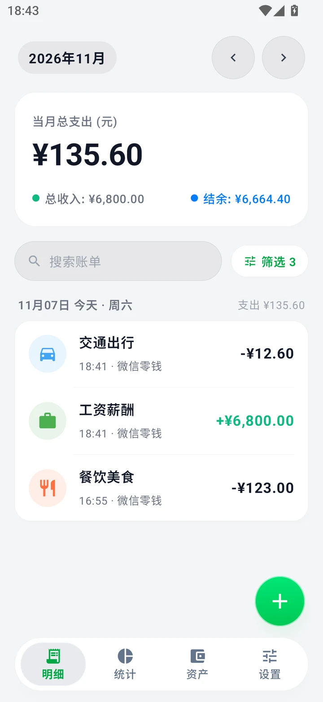
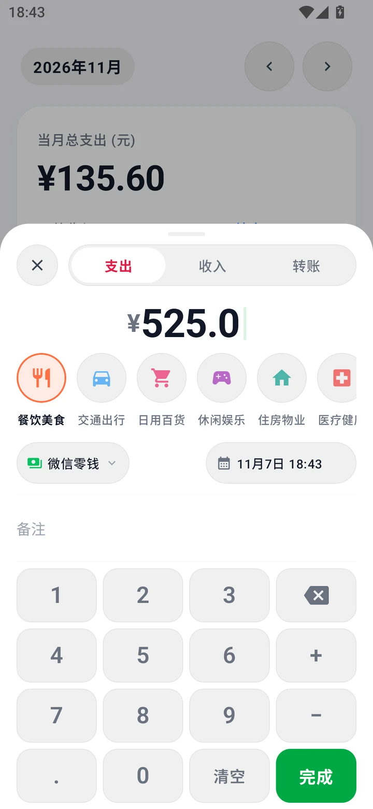
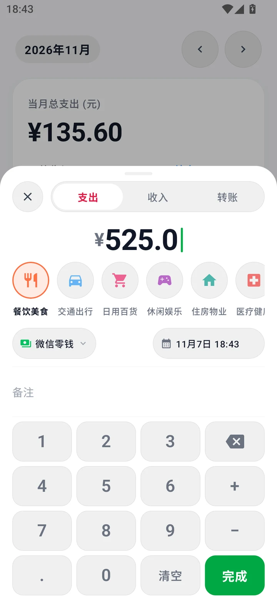
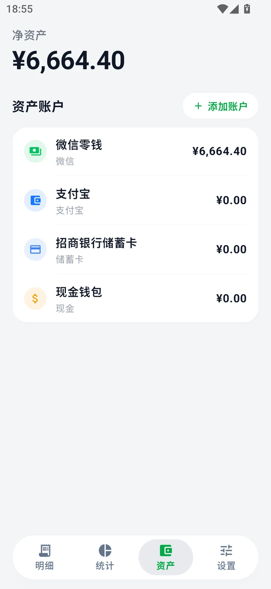
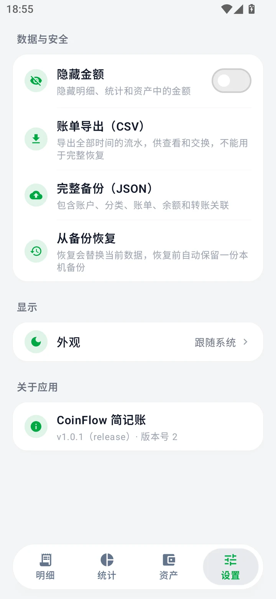
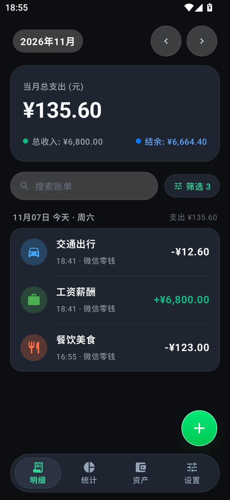

<h1 align="center">💰 简记账 CoinFlow</h1>

<p align="center">
  <strong>一款纯本地离线的极简 Android 记账应用</strong><br/>
  数据不出设备 · 无广告无账号 · Jetpack Compose 液态玻璃设计
</p>

<p align="center">
  <a href="https://github.com/Githao3/bookkeeping/releases/latest"></a>
  <a href="https://developer.android.com/about/versions/nougat"></a>
  
  
  <a href="LICENSE"></a>
</p>

---

## 📸 预览

| 明细 | 记一笔 | 统计 |
| :---: | :---: | :---: |
|  |  |  |
| **资产** | **设置** | **深色模式** |
|  |  |  |

## ✨ 特性

- 💸 **极速记一笔** — 大字金额 + 自定义数字键盘，支持加减表达式实时求值（如 `100+20+3` 即时显示 `= ¥123.00`），支出 / 收入 / 转账三模式一键切换
- 📅 **日期时间滚轮** — 年月日时分五轮联动，按当月实际天数自动收口（2 月 28/29 天正确处理），拨动就近吸附
- 🏦 **多账户资产管理** — 现金 / 微信 / 支付宝 / 银行卡，余额随记账自动联动，删账自动回滚
- 📊 **统计看板** — 月 / 年 / 全部时间范围，支出 / 收入切换，分类排行与占比一目了然
- 🔍 **明细检索** — 自然日分组流水、备注搜索、账户 / 分类 / 日期多维筛选
- 💾 **数据安全** — CSV 流水导出 + JSON 完整备份 / 恢复（含 schema 版本迁移，恢复前自动保留本机快照）
- 🌗 **深色模式** — 跟随系统，全屏适配
- 🎨 **液态玻璃设计语言** — AGSL 光学折射着色器 + 扁平玻璃组件体系，Android 10+ 渲染一致
- 🔐 **彻底离线** — 无账号、无广告、无追踪，所有数据仅存储在设备本地

## 📦 下载安装

前往 [**Releases**](https://github.com/Githao3/bookkeeping/releases/latest) 下载最新的 `CoinFlow-vx.x.x-release.apk`，允许安装未知来源应用后直接安装。

- 系统要求：**Android 7.0（API 24）及以上**
- 升级安装无缝覆盖，账单数据自动保留
- 从早期 debug 测试包迁移：先在设置中导出 JSON 备份 → 卸载旧包 → 安装正式版 → 恢复备份

> 💡 安装时国内 ROM 可能提示「应用未经过 ICP 备案」——本应用完全离线运行，不涉及互联网信息服务，直接忽略该提示继续安装即可。

## 🛠 技术栈

| 层级 | 技术 |
| :--- | :--- |
| 语言 | Kotlin 2.x |
| UI | Jetpack Compose · Material 3 · Navigation 3 · AGSL 着色器 |
| 架构 | MVVM · StateFlow · Repository |
| 数据 | Room 2.8（KSP）响应式本地数据库，schema 版本化迁移 |
| 质量 | 15 条 JVM 单测 + 21 条 Android/Compose 测试 · Lint 0 错误 |

## 🚀 从源码构建

```bash
git clone https://github.com/Githao3/bookkeeping.git
cd bookkeeping
./gradlew.bat assembleDebug        # Debug 包
./gradlew.bat test                 # 全量单元测试
```

用 Android Studio 打开项目目录即可运行调试（JDK 使用 Android Studio 内置 JBR 即可）。

**发布签名**：release 构建会从 `local.properties` 读取签名参数（不入库）：

```properties
RELEASE_STORE_FILE=keystore/your-release.jks
RELEASE_STORE_PASSWORD=xxxx
RELEASE_KEY_ALIAS=your-alias
RELEASE_KEY_PASSWORD=xxxx
```

未配置时 release 自动回退 debug 签名，保证任何人克隆后可直接构建。

## 🔒 隐私

简记账**完全离线运行**：所有账单数据仅存储在您的设备本地数据库中，不联网、不上传、不收集任何个人信息。备份文件由您自行保管。

## 🗺 Roadmap

- [ ] 月度预算与超支预警
- [ ] 桌面小组件（今日收支速览）
- [ ] 周期记账（房租 / 订阅自动入账）
- [ ] 报表图片导出分享

## 📄 许可证

本项目基于 [MIT License](LICENSE) 开源。

## 🙏 致谢

- [Kyant0/AndroidLiquidGlass](https://github.com/Kyant0/AndroidLiquidGlass) — AGSL 液态玻璃折射与色散着色器思路
- [Jetpack Compose](https://developer.android.com/compose) / [Material 3](https://m3.material.io/) / [Room](https://developer.android.com/training/data-storage/room)
- 设计灵感：酷安液态玻璃胶囊底栏、iCost / Moze 记一笔交互
- 应用图标 3D 插画素材由项目作者提供

---

<p align="center">如果这个项目对你有帮助，欢迎点个 ⭐ Star</p>
